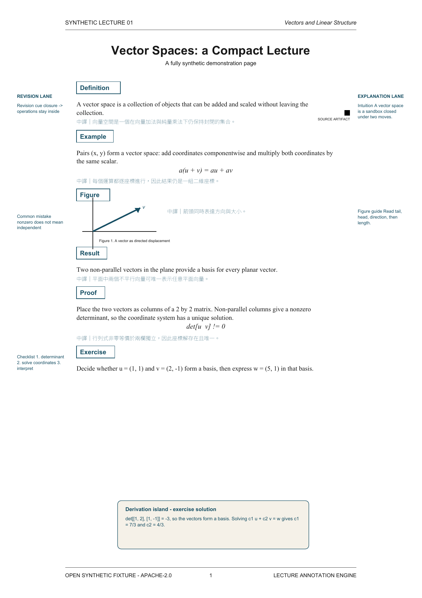

# Lecture Annotation Engine

> Preserve the lecturer's visual language; augment the learning experience rather than redesign the document.

Lecture Annotation Engine is an open, geometry-aware foundation for adding inline bilingual translation, normalized mathematics, and pedagogical notes to lecture PDFs while treating every original mark as **Immutable source ink**.

> [!WARNING]
> **Phase 1 - Not production-ready.** This release defines public contracts, a synthetic demonstration, and tested parser/layout/QA skeletons. It does not yet translate arbitrary PDFs or run a production layout optimizer.



The preview and both example PDFs are deliberately synthetic. No professor-authored lecture PDF or translated derivative is included.

## Architecture

```text
CourseProfile + LectureIR
        |          |
        v          v
    Anchor Graph -> Bilingual Reflow -> Region/Lane Planner
                                            |
                                            v
                                 Enrichment Engine -> Renderer
                                                           |
                                                           v
                                                Visual QA / Repair Loop
```

- **CourseProfile** records recurring page, typography, lane, collision, font, footer, and enrichment policies.
- **LectureIR** is the renderer-independent document contract for semantic regions, geometry, source ink, translations, annotations, and layout constraints.
- The planner computes free space only after semantic grouping, bilingual insertion, anchor reflow, and elastic-footer adjustment.
- Actual source ink is protected; the safety halo is a soft clearance preference.
- Margin roles are profile-driven, never globally assumed.

Read [the architecture](docs/architecture.md) and [Specification v1.0](docs/specification-v1.md) for the complete Phase 1 contract.

## Public contracts

- [CourseProfile JSON Schema](schemas/course-profile.schema.json) - course-level visual and placement policy.
- [LectureIR JSON Schema](schemas/lecture-ir.schema.json) - reusable document intermediate representation.
- [Portable agent workflow](SKILL.md) - inspect, profile, build IR, reflow, place, render, verify, and repair.
- [Engineering invariants](AGENTS.md) - non-negotiable source-preservation and regression rules.

Typography defaults are explicit: translations and annotations target 7-8 pt and may not be rendered below 5.5 pt. Enrichment coverage is 100%, candidate-generation depth is unbounded, and visible rendering remains constrained by layout capacity.

## Synthetic demo

- Source: [`examples/synthetic-input/synthetic-lecture.pdf`](examples/synthetic-input/synthetic-lecture.pdf)
- Annotated output: [`examples/synthetic-output/synthetic-annotated.pdf`](examples/synthetic-output/synthetic-annotated.pdf)
- LectureIR fixture: [`examples/synthetic-input/lecture-ir.json`](examples/synthetic-input/lecture-ir.json)

The one-page A4 fixture contains a Definition, Example, Result, Proof, Exercise, vector Figure, equations, left/right semantic lanes, footer, inline Traditional Chinese translation, a coherent derivation island, and an artificial black-square source artifact.

## Quick start

```bash
python -m pip install -e ".[dev]"
python -m unittest discover -s tests -p "test_*.py" -v
python scripts/generate_synthetic_demo.py
python scripts/verify_pdf.py --help
```

The demo generator looks for an embeddable CJK font. Set `LAE_CJK_FONT` to a local TTF/TTC font when no supported system font is found. `pdftoppm` is required to refresh the preview.

## Current scope

Implemented in Phase 1:

- validated CourseProfile and LectureIR schemas;
- logical text-span grouping;
- normalized page geometry and collision-safe placement selection;
- metadata-level QA reporting;
- deterministic vector synthetic PDFs with embedded CJK glyphs;
- script entry points for inspect, IR, source-mask, overlay, and verification stages;
- documentation of layout, enrichment, QA, and prior-art decisions.

Planned next: real PDF parsing and source masks, anchor-graph construction, translation adapters, LaTeX math normalization, capacity-aware placement optimization, vector overlay composition, and rendered visual regression.

## Documentation

- [Course profiling](docs/course-profile.md)
- [LectureIR](docs/lecture-ir.md)
- [Placement engine](docs/placement-engine.md)
- [Enrichment](docs/enrichment.md)
- [Visual QA and repair](docs/qa.md)
- [Prior art and licenses](docs/prior-art.md)

## Copyright and license

Do not add copyright-protected lecture material to public fixtures without verified redistribution permission. Use synthetic or explicitly licensed samples.

The project is licensed under [Apache-2.0](LICENSE).
